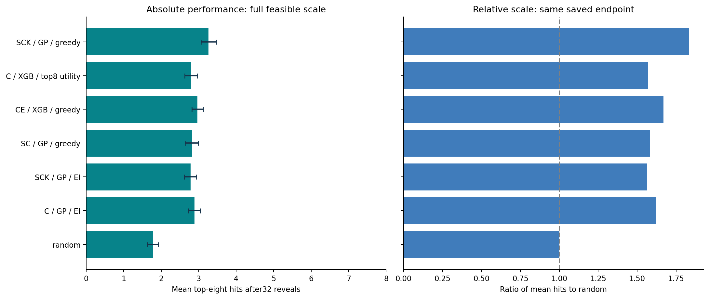
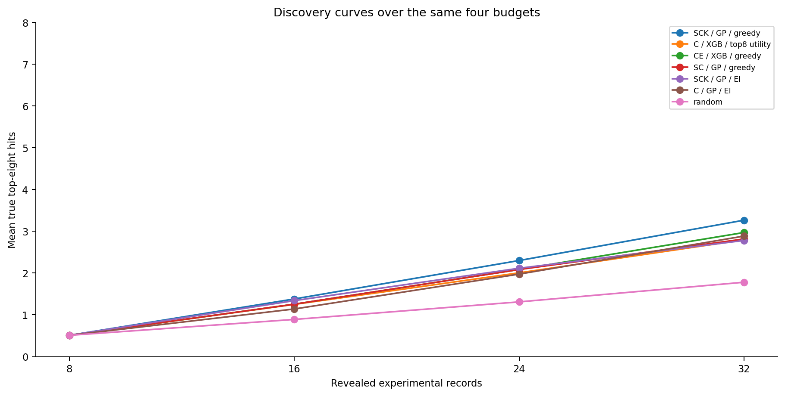

# PepLab Bench

**Which information source helps which model and selection rule?** A transparent peptide-selection benchmark with plug-in interfaces and a complete saved development study.

**160 HLA-A*02:01 nine-mers · 151 configurations · 200 shared starts · 30,200 episodes.**

Each episode starts with eight measured candidates, then selects three batches of eight. All methods share the same initial eight per start. Measurements are archived experimental IC50 values, revealed from a cached oracle. They are not new assays.

## Start in two minutes

Python 3.10+; viewing and contract tests require no numerical dependencies:

```bash
python -m pip install -e .
peplab-bench verify --data data
peplab-bench results --data data --html results.html
python -m unittest discover -s tests -v
```

Open `results.html` to compare every method. The command reads saved summaries and performs no fitting. Downloadable complete data and software archive links will be added after the reviewed release receives its actual persistent identifiers; no placeholder DOI is a citation.

## Findings at a glance

| Source / predictor / selector | Mean top-8 hits after 32 reveals |
|---|---:|
| Sequence + chemistry + contacts / GP / greedy | **3.265** |
| Chemistry + direct energy / XGB bootstrap / greedy | 2.970 |
| Chemistry / XGB bootstrap / greedy | **2.920** |
| Sequence + chemistry / GP / greedy | 2.815 |
| Chemistry / XGB bootstrap / top-8 utility | 2.795 |
| Random | 1.780 |

The observed leader recovered 1.485 more hits than random and 0.345 more than the best cheap-only combination. It was selected on development results; this is not a prospective superiority estimate. Adding a source sometimes helps and sometimes harms. All 151 summaries and 280 matched source-addition contrasts are included, not just the leader.

The study was extended from 20 to 200 starts after inspecting the original results. The original 3,020 episodes remain unchanged; 27,180 were added. Standard deviations describe initialization variability and MCSE describes precision over random starts on this same dataset. These are not 200 independent biological experiments.





## Three independent axes

| Axis | Options |
|---|---|
| Source | S: 320 fixed ESM2 features; C: 2,058 chemistry features; K: 36 prepared contact features; E: 2 direct interaction-energy features |
| Predictor | GP; XGBoost with 16 bootstrap members |
| Selector | Greedy; expected improvement; UCB; Thompson sampling; top-8 utility |

All 15 nonempty source subsets × 2 predictors × 5 selectors, plus random. **Greedy is a selector, not an information source.** Contacts and energies are distinct source blocks. The structural inputs are template-informed prepared poses; earlier blind-docking recovery failures are part of the provenance. Direct energies are proxies, not binding free energies.

## Bring your model

Implement a predictor accepting `visible` labels, unlabeled feature blocks and ordered query IDs. Return `Prediction(ids, means, covariance, observation_noise, uncertainty_label)`. A mean-only model supports greedy selection. Bayesian acquisitions are unavailable until a valid covariance is supplied. Uncertainty must be described honestly; the reference GP and finite-bootstrap uncertainties are uncalibrated.

See [integration guide](docs/INTEGRATION.md), [methods](docs/METHODS.md), [data dictionary](docs/DATA.md) and [release provenance](docs/PROVENANCE.md). Replace a predictor, selector or source independently. A mock integration example is in `examples/custom_predictor.py`.

## Opt in to a fresh single-episode replay

This performs actual CPU model fits and is separate from viewing the completed study:

```bash
python -m pip install -e '.[models]'
peplab-bench replay --data data --sources SCK --predictor GP \
  --selector greedy --seed 2026110420 --out my-new-episode
```

The numerical functions retain the original ASTs; the portable wrapper and adapter layer are new. They have contract tests, not a newly completed 30,200-episode portability replication. A new episode never appends to the frozen results. Outputs use exclusive creation and record selections before reveals. Cached values are isolated by software flow, not by an OS security boundary.

To run the complete factorial for one new replication start, use `peplab-bench benchmark --data data --starts 1 --out my-new-suite`. Set `--starts 200` and an explicit `--max-seconds` only when you intend the full workload. This new portable runner seals every planned episode before asking its separate oracle for the full response table, fails closed on an incomplete suite and writes a separate replication table. It does not launch cloud resources or overwrite the archived study. Its orchestration is new and still awaits a full numerical portability replication; the global-barrier contract is tested with mock values.

## Scope

This release supports reproducible retrospective source/model/selector comparison on one finite, previously exposed HLA cohort. Source features were available upfront. It does not establish cost-aware allocation across evaluation layers, affinity prediction for arbitrary peptides, prospective wet-lab benefit, trillion-candidate search performance, or calibrated uncertainty. The reserved 40 outcomes are excluded from every release file. Their broader historical exposure is not certified by this extension.

## Citation and reuse

Author: **Oğuzcan Unver**. Original code: Apache-2.0. Original manuscript/documentation: CC BY 4.0. IEDB-derived data: attribution and source terms in [third-party notices](THIRD_PARTY_NOTICES.md). Cite the original experiment (DOI `10.4049/jimmunol.0901607`), IEDB and the versioned PepLab release. No pretrained weights or third-party runtime binaries are bundled.

AI tools assisted software development, execution support, analysis presentation and manuscript drafting. Human author review and responsibility are required. Publication and peer-review status are stated in `docs/PUBLICATION.md`.
